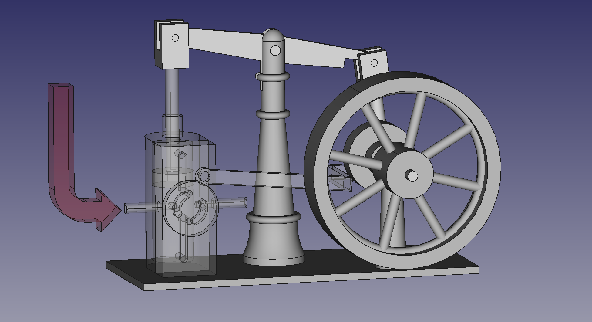

# 🚂 Miniature Beam Steam Engine – FreeCAD 3D CAD Model

A free, open-source **3D CAD model of a miniature beam steam engine**, made in **FreeCAD** with the **Assembly4 workbench**. Use it to study or teach how a working model steam engine turns the piston's up-and-down motion into rotation.

## 📖 About this beam steam engine model

### What is a beam engine?

A **beam engine** is one of the earliest types of **steam engine**, first used in the 18th century to pump water out of mines. The piston pushes a rocking beam that pivots overhead. The beam drives a connecting rod and crank, which turn the flywheel and change the piston's up-and-down motion into rotation.

### About this model

The original **miniature beam steam engine** was designed by **Lutz Hielscher**. I bought one on eBay, measured it by hand and rebuilt it as a **FreeCAD assembly**. I made the model for an **educational YouTube video** that explains how a steam engine works.

This repository may be useful to:

- 🎓 **Students and teachers** learning about steam power, thermodynamics or mechanisms
- 🔧 **Model engineers and hobbyists** interested in live steam and miniature steam engines
- 🖥️ **FreeCAD users** looking for an example Assembly4 mechanism

> ⚠️ **Note:** The model is based on my own measurements, so it is not 100% accurate and does not include every part. It is good for showing how the engine moves, but it is not meant to be used as a manufacturing drawing.

## 🎥 Video: How a beam steam engine works

You can see this miniature steam engine in action in the YouTube video:

## 📂 Repository Contents

| File | Description |
|------|-------------|
| [`steam_engine_mechanism.FCStd`](steam_engine_mechanism.FCStd) | FreeCAD (Assembly4) 3D model of the beam steam engine mechanism |
| [`docs/steam_engine_overview.png`](docs/steam_engine_overview.png) | Overview rendering of the steam engine CAD model |
| [`docs/`](docs/) | Source of the [project website](https://kenfilms.github.io/Miniature-Beam-Steam-Engine-CAD/) (GitHub Pages) |
| [`LICENSE`](LICENSE) | MIT License |

## 🛠️ Requirements

To open the FreeCAD files, you need:

- [FreeCAD](https://www.freecad.org/index.php)
- The [Assembly4 Workbench](https://wiki.freecad.org/Assembly4_Workbench), which you can install from FreeCAD's **Tools → Addon Manager**

## 🚀 How to open the steam engine CAD model

1. Install FreeCAD and the Assembly4 Workbench.
2. Clone or download this repository.
3. Open `steam_engine_mechanism.FCStd` in FreeCAD.

## 🙏 Credits

- Original engine design: **Lutz Hielscher**
- CAD model and video: **Ken Friedl** ([KenFilms](https://github.com/KenFilms))

## 📄 License

This project is licensed under the [MIT License](LICENSE).
