# 🚂 Miniature Beam Steam Engine – FreeCAD 3D CAD Model

A free, open-source **3D CAD model of a miniature beam steam engine**, made in **FreeCAD** with the **Assembly4 workbench**. Use it to study or teach how a working model steam engine turns the piston's up-and-down motion into rotation.

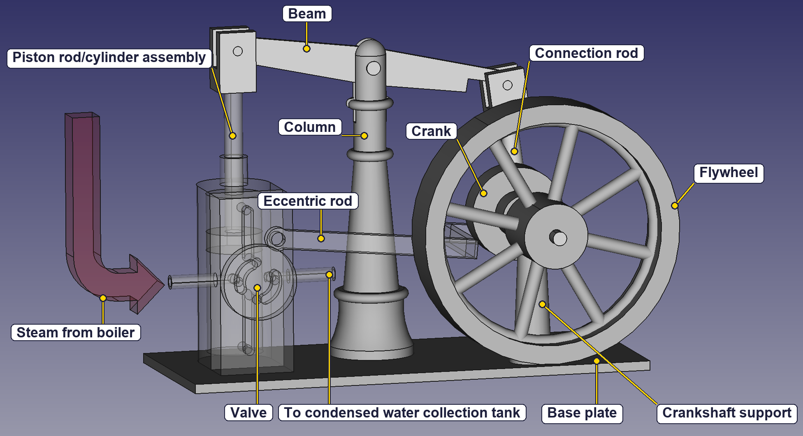

The real brass engine from the video, labeled with the same part names:

## 🎥 Video: How a beam steam engine works

You can see this miniature steam engine in action in the YouTube video:

## 🔄 The movement cycle

The piston moves up and down, rocks the beam, and the connecting rod turns the crank and the flywheel. On the left is one full revolution of the CAD model, seen from the back. On the right is the real brass engine running on steam.

| CAD model (rear view) | Real brass engine |
|:---:|:---:|
| 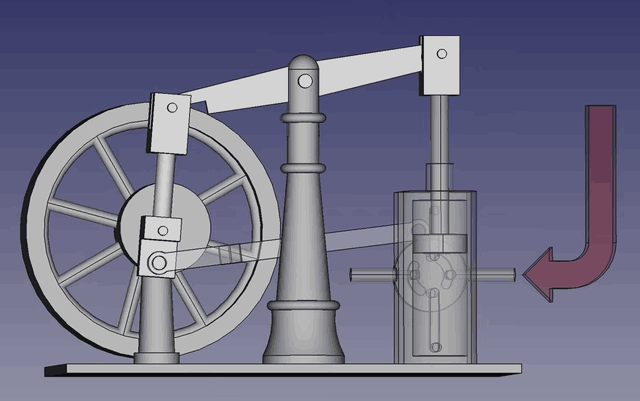 | 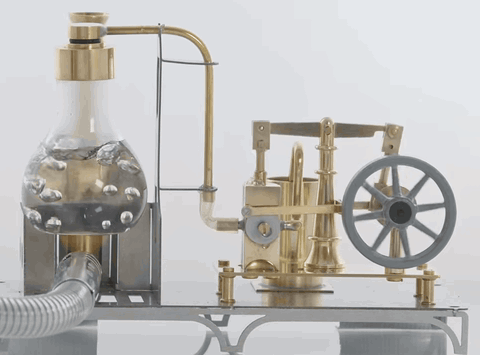 |
| [watch at 17:08](https://youtu.be/Y00JR4w22Pw?t=1028) | [watch at 14:11](https://youtu.be/Y00JR4w22Pw?t=851) |

## 🔧 Building the brass model

The real engine is a brass kit by Lutz Hielscher. These frames from the video show it going from parts to a running machine.

| 1. The parts of the kit | 2. Fitting the rotary valve |
|:---:|:---:|
| [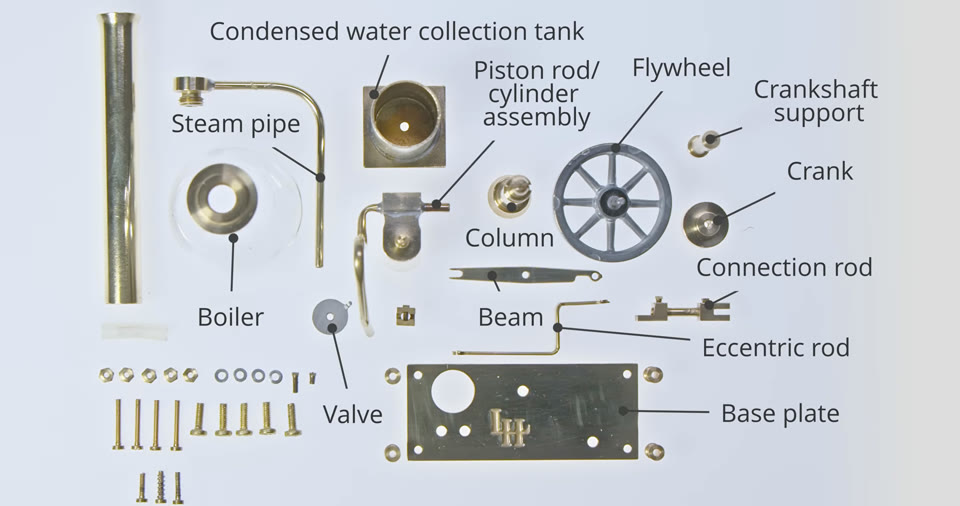](https://youtu.be/Y00JR4w22Pw?t=68) | [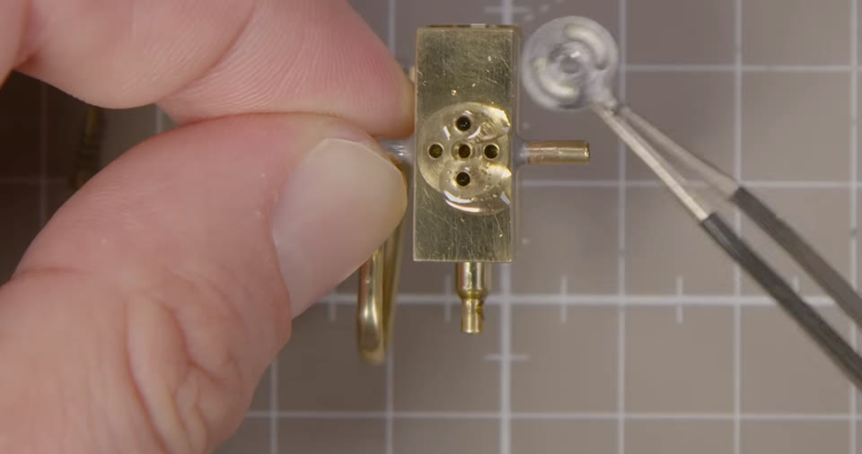](https://youtu.be/Y00JR4w22Pw?t=131) |
| **3. The assembled engine** | **4. The finished machine with boiler** |
| [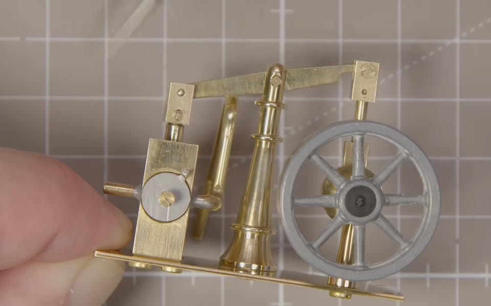](https://youtu.be/Y00JR4w22Pw?t=503) | [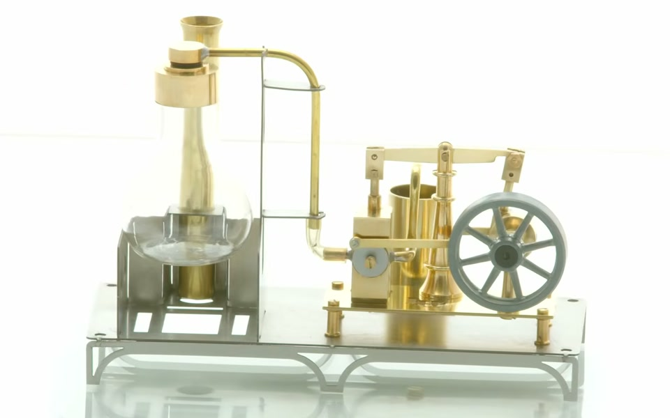](https://youtu.be/Y00JR4w22Pw?t=756) |

Click a picture to jump to that moment in the video.

## ⚙️ How the rotary valve works

The cylinder is **double-acting**: steam pushes the piston both down and up. A small **rotary valve** on the side of the cylinder decides which end gets the steam. The **eccentric rod** from the crank rocks the valve back and forth between two positions. The screenshots below come from the CAD model in the video ([watch from 15:10](https://youtu.be/Y00JR4w22Pw?t=910)).

🟧 **Orange** = fresh steam from the boiler 🟦 **Blue** = used steam going out to the condenser

| Steam to the top → piston moves **down** | Steam to the bottom → piston moves **up** |
|:---:|:---:|
| 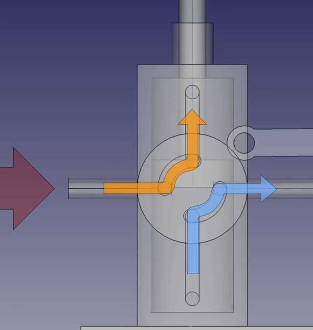 | 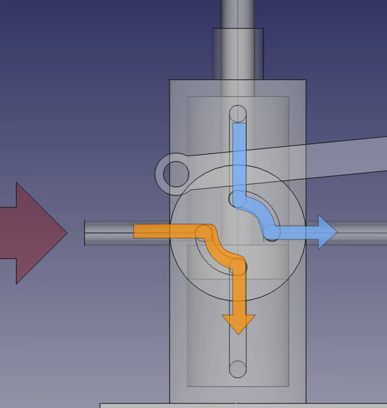 |

### The 90° phase shift

The valve must not move in step with the piston. It has to be **90° behind the crank**. When the piston is moving fastest in the middle of the cylinder, the valve stands still. When the piston reaches the end of its stroke, the valve switches over. If the valve and crank were at the same angle, the engine would not move at all.

This design gets the 90° for free: the cylinder sits beside the crank, so the eccentric rod is already at a right angle to the connecting rod ([watch at 18:05](https://youtu.be/Y00JR4w22Pw?t=1085)).

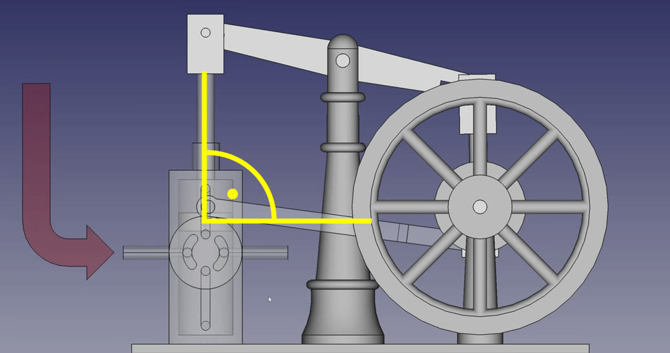

### Reversing the direction

To make the flywheel turn the other way, shift the valve by **180°** relative to the crank. You could attach the eccentric rod on the opposite side of the crank. It is even easier to turn the valve itself by 180° ([watch at 18:52](https://youtu.be/Y00JR4w22Pw?t=1132)). At the end of the video, the real engine runs in reverse ([watch at 19:10](https://youtu.be/Y00JR4w22Pw?t=1150)).

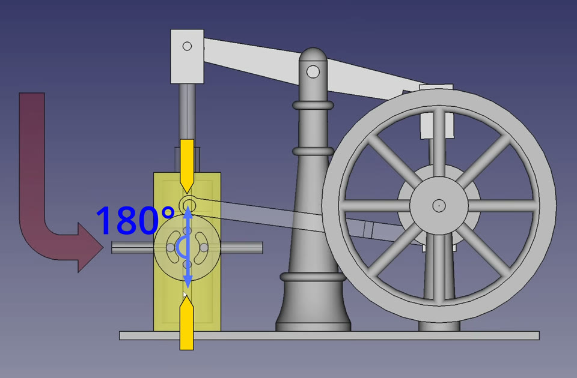

## 📖 About this beam steam engine model

### What is a beam engine?

A **beam engine** is one of the earliest types of **steam engine**, first used in the 18th century to pump water out of mines. The piston pushes a rocking beam that pivots overhead. The beam drives a connecting rod and crank, which turn the flywheel and change the piston's up-and-down motion into rotation.

### About this model

The original **miniature beam steam engine** was designed by **Lutz Hielscher**. I bought one on eBay, measured it by hand and rebuilt it as a **FreeCAD assembly**. I made the model for an **educational YouTube video** that explains how a steam engine works.

This repository may be useful to:

- 🎓 **Students and teachers** learning about steam power, thermodynamics or mechanisms
- 🔧 **Model engineers and hobbyists** interested in live steam and miniature steam engines
- 🖥️ **FreeCAD users** looking for an example Assembly4 mechanism

> ⚠️ **Note:** The model is based on my own measurements, so it is not 100% accurate and does not include every part. It is good for showing how the engine moves, but it is not meant to be used as a manufacturing drawing.

## 📂 Repository Contents

| File | Description |
|------|-------------|
| [`steam_engine_mechanism.FCStd`](steam_engine_mechanism.FCStd) | FreeCAD (Assembly4) 3D model of the beam steam engine mechanism |
| [`docs/steam_engine_overview.png`](docs/steam_engine_overview.png) | Overview rendering of the steam engine CAD model |
| [`docs/steam_engine_overview_labeled.png`](docs/steam_engine_overview_labeled.png) | The same rendering with all main parts labeled |
| [`docs/brass_overview_labeled.jpg`](docs/brass_overview_labeled.jpg) | Photo of the real brass engine from the video with labeled parts |
| `docs/valve_*.jpg` | Screenshots from the video that explain the rotary valve |
| `docs/movement_cycle_*.gif` | Animations of the movement cycle (CAD model and real engine) |
| `docs/brass_*.jpg` | Frames from the video showing the brass kit being built |
| [`docs/`](docs/) | Source of the [project website](https://kenfilms.github.io/Miniature-Beam-Steam-Engine-CAD/) (GitHub Pages) |
| [`LICENSE`](LICENSE) | MIT License |

## 🛠️ Requirements

To open the FreeCAD files, you need:

- [FreeCAD](https://www.freecad.org/index.php)
- The [Assembly4 Workbench](https://wiki.freecad.org/Assembly4_Workbench), which you can install from FreeCAD's **Tools → Addon Manager**

## 🚀 How to open the steam engine CAD model

1. Install FreeCAD and the Assembly4 Workbench.
2. Clone or download this repository.
3. Open `steam_engine_mechanism.FCStd` in FreeCAD.

## 🙏 Credits

- Original engine design: **Lutz Hielscher**
- CAD model and video: **Ken Friedl** ([KenFilms](https://github.com/KenFilms))

## 📄 License

This project is licensed under the [MIT License](LICENSE).
